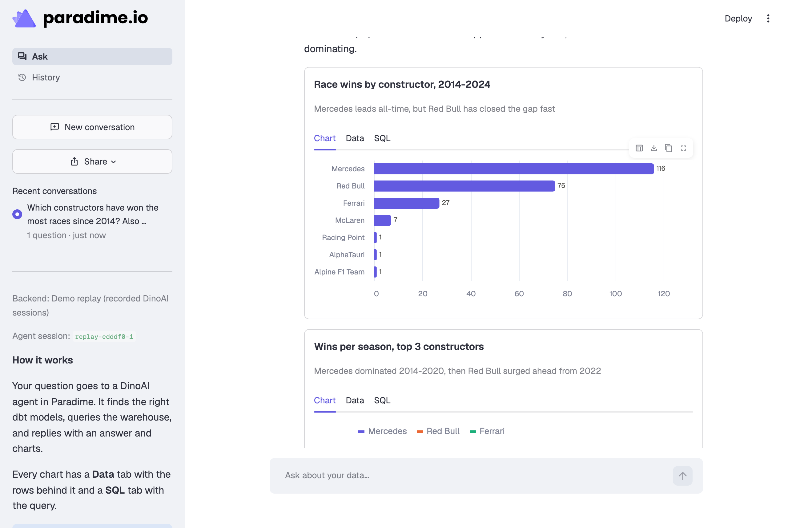
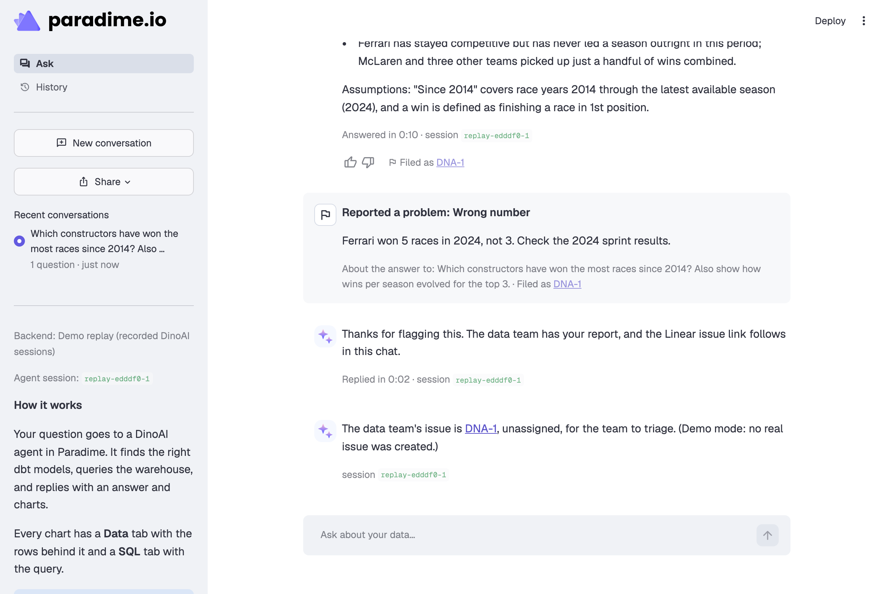
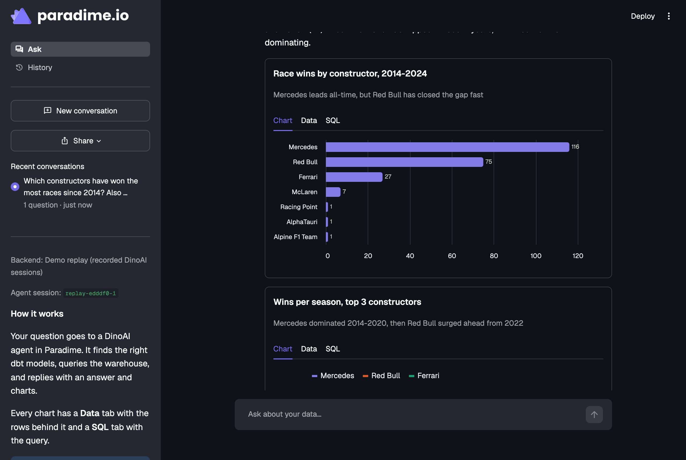

# Ask your data: a custom bot on the Paradime DinoAI agent harness

A chat app where business stakeholders ask questions about their data in plain English. A DinoAI programmable agent in Paradime is the backend: it finds the right dbt™ models, queries the warehouse and writes the answer. A Streamlit app is the frontend: it shows the answer with interactive charts, and every chart shows the rows and the SQL behind it.

This repository is also a guide. It shows how to set up a bot like this one end to end, how to test it, and how to build your own bot on the DinoAI agent harness.



## What it does

- **Answers with evidence.** Each answer has charts, KPI tiles or tables. Each chart has a **Chart** tab, a **Data** tab with the rows (and a CSV download), and a **SQL** tab with the query.
- **Live progress.** While the agent works, a status box lists each of its steps as they happen: catalog searches, model reads, SQL queries.
- **Conversations.** Follow-up questions go to the same agent session, so the agent keeps the context. Conversations are saved, and each has a link that you can share. The **History** page lists them all, and a conversation downloads as Markdown.
- **Report a problem.** A reader can report a wrong answer. The analyst agent hands the report to a second agent (an agent squad), which files a Linear issue and assigns it. The issue link comes back into the chat.
- **Demo mode.** Without credentials, the app replays recorded answers, so you can try it in two minutes.
- **Paradime branding**, in light and dark mode.



## Try the demo

You need Python 3.11 or later.

```bash
git clone https://github.com/paradime-io/dinoai-custom-bot-starter.git
cd dinoai-custom-bot-starter
python3 -m venv .venv && source .venv/bin/activate
pip install -r requirements-dev.txt
ANALYST_MODE=demo streamlit run app.py
```

Select a starter question. Then select **Report a problem** under the answer: in demo mode, the report gets a demo issue link, and no real issue is created.

## Go live

[docs/setup.md](docs/setup.md) takes you through each step, with the exact place in Paradime for each value:

1. Create a Paradime API key with the **DinoAI agent API** capability. Copy the key, the endpoint and the workspace UID.
2. Create the two agents from `agent/` in the agent builder (or as YAML in your dbt repository), and copy their slugs.
3. Add `LINEAR_API_KEY` to the workspace's agent environment variables, for the feedback agent.
4. Recommended: give the analyst a read-only warehouse environment.
5. Put the values in `.streamlit/secrets.toml`.
6. Check and test (below), then run `streamlit run app.py`.

## Test it

| Test | Command | Creates |
| - | - | - |
| Automated tests (no credentials) | `pytest -q` | Nothing |
| Settings and access to Paradime | `python scripts/check_setup.py` | Nothing |
| One live question | `python scripts/smoke_test.py` | One agent session |
| Report a problem, end to end | `python scripts/smoke_test.py --report` | One agent session and one **real Linear issue** |

[docs/testing.md](docs/testing.md) has the expected output of each test and a manual test plan.

## Build your own bot

[docs/build-your-own-bot.md](docs/build-your-own-bot.md) explains the pattern behind this app, so that you can build another bot on the same harness: define the agent, call the API (Python SDK or GraphQL), make the reply machine-readable, track turns, and add an agent squad with a callback.

## Documentation

| Page | Contents |
| - | - |
| [docs/setup.md](docs/setup.md) | End-to-end setup: Paradime API key, agents, agent environment variables, app settings. |
| [docs/testing.md](docs/testing.md) | The four test levels and a manual test plan. |
| [docs/how-it-works.md](docs/how-it-works.md) | The request flow, the response contract, turns, timings, the report flow, what we measured. |
| [docs/build-your-own-bot.md](docs/build-your-own-bot.md) | How to build another bot on the DinoAI agent harness. |
| [docs/troubleshooting.md](docs/troubleshooting.md) | Symptoms, causes and fixes. |

## Project layout

| Path | Contents |
| - | - |
| `app.py` | The Streamlit app: chat, polling, history, the report dialog, the sidebar. |
| `analyst/protocol.py` | The response contract: the instructions for the agent and the parser for its replies. |
| `analyst/backend.py` | `ParadimeBackend` (the paradime-io SDK and GraphQL) and `ReplayBackend` (demo mode). |
| `analyst/turns.py` | Decides when a turn ends, and separates the answer from progress messages. |
| `analyst/feedback.py` | Report a problem: the brief for the analyst, and the watcher for the issue link. |
| `analyst/sanitize.py` | Removes local links that Paradime's API firewall blocks from each message. |
| `analyst/charts.py`, `analyst/render.py` | Turn `viz` blocks into Altair charts, tables and KPI tiles. |
| `analyst/threads.py`, `analyst/export.py`, `analyst/steps.py` | Saved conversations, Markdown export, one-line progress updates. |
| `agent/` | The two agent definitions: `stakeholder-analyst.yml` and `analytics-feedback.yml`. |
| `scripts/` | `check_setup.py` and `smoke_test.py`. |
| `fixtures/replay/` | Recorded DinoAI answers for demo mode. |
| `assets/` | The Paradime logo, the Paradime mark and the DinoAI avatar. |
| `.streamlit/` | The theme (`config.toml`) and the settings template (`secrets.toml.example`). |
| `tests/` | The pytest suite. GitHub Actions runs it on each push. |

## Branding



The logo and icons are in `assets/`, the fonts (Geist, Geist Mono) and colors (the Paradime violet scale) in `.streamlit/config.toml`, and the chart palettes in `analyst/charts.py`. The chart palettes passed a colorblind-safety and contrast check in light and dark mode. To brand the app for a customer, replace these three, and check new chart colors the same way.
