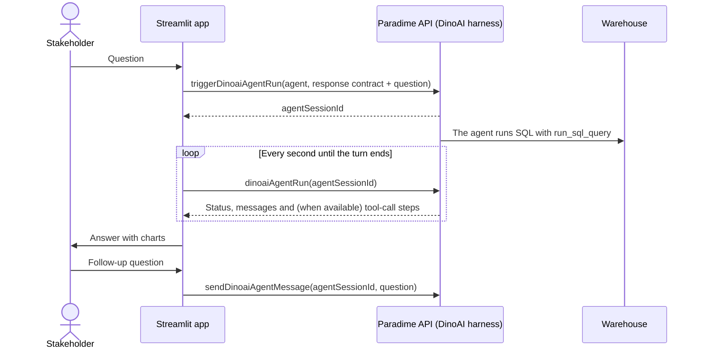
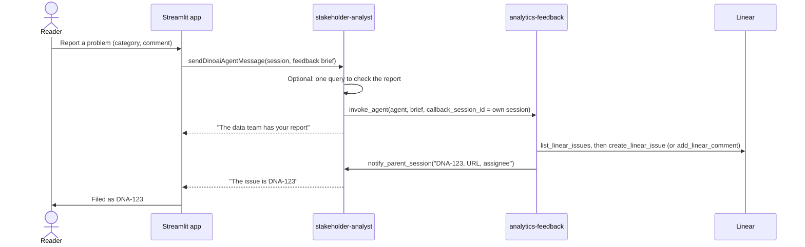

# How it works

This page explains the moving parts: the agent session, the response contract, the turn logic, history, the report flow, and what we measured on the real harness. For the setup steps, see [setup.md](setup.md).

## The request flow



- **One conversation is one agent session.** Follow-ups go to the same session, so the agent keeps the context.
- **The session ID is the thread ID.** The app puts it in the URL (`?thread=<id>`) and saves the conversation in `.threads/`. A page reload, a new tab or a server restart opens the same thread again, and an answer that was in progress continues.
- **The agent pod is not permanent.** The Paradime docs say it stays alive for up to 24 hours after the last message, and 48 hours in total. Some runtimes use shorter limits: on the AgentCore runtime, the backend sets 25 minutes without activity and about 8 hours in total. If Paradime refuses a follow-up, the chat shows a notice, and the question starts a new session that gets a summary of the conversation so far.
- **The API returns Markdown messages only.** So visuals travel inside the message, as fenced `viz` blocks that hold one JSON object each (see [The response contract](#the-response-contract)).
- **The app sends the response contract at the start of each session.** The agent definition only says who the agent is and which tools it can use.
- **The app polls the run every second** (`ANALYST_POLL_SECONDS`). While the agent works, the status line shows the agent's latest step and a timer. The last message of the turn is the answer.

## The response contract

The contract is in `analyst/protocol.py`. It has two parts that must stay in sync: the instructions that the app sends to the agent, and the parser for the agent's reply. Change both together and increase `PROTOCOL_VERSION`.

An answer is one Markdown message. Each visual is a fenced block with the `viz` tag:

````markdown
Mercedes has won the most races since 2014 with 116 wins.

```viz
{"type": "bar", "title": "Race wins by constructor, 2014-2024", "x": "constructor_name", "y": "wins",
 "horizontal": true, "format": {"wins": ",.0f"},
 "sql": "SELECT constructor_name, COUNT(*) AS wins FROM ...",
 "columns": ["constructor_name", "wins"], "rows": [["Mercedes", 116], ["Red Bull", 75]]}
```

- Red Bull won 21 of 22 races in 2023.
````

| `type` | Use | Fields |
| - | - | - |
| `bar` | Compare categories | `x`, `y`, optional `color`, `horizontal`, `stack` |
| `line` | Trend over time | `x`, `y`, optional `color` |
| `area` | One cumulative series, or stacked series | `x`, `y`, optional `color` |
| `scatter` | Relation between two measures | `x`, `y`, optional `color`, `label` |
| `pie` | Share of a whole, 6 slices or fewer | `x`, `y` |
| `heatmap` | One measure across two categories | `x`, `y`, `value` |
| `table` | Rows to scan | optional `columns` |
| `metrics` | Headline numbers (KPI tiles) | `items`: `label`, `value`, `format`, `delta` |

- All types except `metrics` carry the query rows and the `sql`. Rows come either as compact `columns` plus `rows` arrays (the contract asks for these, because they are shorter to type) or as `data`, a list of objects.
- The parser also accepts `vega-lite` blocks and repairs common JSON errors, for example trailing commas. If a block is not valid, the app shows a warning and the raw JSON. It does not fail.
- The chart look comes from `analyst/charts.py`, not from the agent: one validated palette for light and dark mode, thin marks, value labels, a hover tooltip on every chart, and one color for each entity in all charts of a conversation. If one chart has measures with different scales (for example points and wins), the app shows one panel for each measure.
- Each chart has a **Chart** tab, a **Data** tab with the rows behind it (and a CSV download), and a **SQL** tab with the query.

## Turns: when is an answer finished?

The harness exposes a session as one growing transcript and a status. A turn is "the agent messages that appeared after we sent our message" (`analyst/turns.py`).

- A first question ends when the run is no longer active (`COMPLETED`, `FAILED`, `EXPIRED` or `STOPPED`).
- A follow-up is harder: right after the app sends it, the run can still report the previous turn's `COMPLETED` for a moment. So a terminal status ends a follow-up only after the app saw the run active again, or after the new messages stopped for 8 seconds.
- The answer is the last message of the turn, plus any earlier message that has a visual. The other messages are progress notes, shown in a collapsed "Agent activity" section.

## Where the time goes

The Paradime API has no push channel: the schema has no GraphQL subscription, and messages arrive complete. So the app cannot stream text as the agent writes it. We measured live turns on the `f1-data-bq` workspace:

| Step | First question | Follow-up |
| - | - | - |
| Run queued while the agent pod starts | 17 s | 0 s (the pod is warm) |
| Agent work (find models, run SQL, write the answer) | 33 s | 20 s |
| App delay after the answer is posted | 0.3 s | 0.0 s |
| Total | 50 s | 20 s |

The agent types every chart row into its answer, and that takes time. With compact rows, at most 2 visuals and at most 60 rows for each visual, the same question went from an 8,701-character answer after 72 s to a 3,662-character answer after 59 s (one run each).

To make answers faster, change the agent, not the frontend:

- **Model family.** Set `DINOAI_MODEL_FAMILY` to a Fast preset of the workspace (see the Model section of the agent builder). If Paradime does not know the slug, it uses the default family, and the chat shows its warning.
- **Less exploration.** Put the key marts and their columns in `ANALYST_CONTEXT` or in the agent's backstory. The agent then spends less time on discovery tool calls.
- **A warm pod.** The first question pays for the pod start. An app could start the session when the page opens, at the cost of one agent session for each visit.

### Live tool calls

The Paradime app shows the agent's tool calls while it works. The external API's `dinoaiAgentRun.messages` holds only what the agent delivered with `send_api_message`. Newer Paradime releases add two opt-in fields to `DinoAiAgentRun`, which not every environment has yet:

```graphql
steps(after: Int, includeToolIo: Boolean = false, maxChars: Int = 2000): [DinoAiAgentStep!]
#   DinoAiAgentStep { index, role: USER|AGENT|TOOL, toolName, toolInput, content, truncated }
startupSteps: [DinoAiAgentStartupStep!]   # the pod start-up checklist: { label, done }
```

The app already asks for these fields. It shows one line for each step ("Ran a SQL query: SELECT race_year, …") and the start-up checklist while the pod starts. On an API without the fields, the first read is refused, and the app uses the plain query from then on. Until the change is deployed, the contract asks the agent to post a short line before each tool call.

## History and sharing

- **Recent conversations.** The sidebar of the Ask page lists the 8 most recent conversations, with their number of questions and last activity.
- **History page.** It lists every conversation saved on this app server, newest first: last activity, the first question, the number of questions, the status, the thumbs-up/down feedback and the Linear issues filed for reported problems. Each row has an **Open** link.
- **Share.** The **Share** button gives the link of the open conversation and a **Download as Markdown** option. The Markdown file holds the questions, the answers, and each chart as a table of its rows (up to 50) with its SQL.

Anyone who can open the app sees every conversation on the History page, and anyone with a link can read that conversation and ask follow-ups in it. If you turn on Streamlit sign-in (`st.login`), the History page also shows who asked each conversation.

## Report a problem (an agent squad)

A reader can tell the data team that an answer is wrong. DinoAI files the report as a Linear issue and posts the issue link in the chat. The report goes through the analyst agent and its agent squad:



1. Under an answer, the reader selects **Report a problem**. A thumbs-down opens the same dialog. The reader selects a category (Wrong number, Missing data, Unclear answer, Other) and can add a comment.
2. The app sends the report to the conversation's own DinoAI session (`analyst/feedback.py`). The message holds the question, the answer, the SQL of each visual, the conversation link (when the app has a public address) and, with sign-in, the reader's email.
3. The analyst can run one query to check the report. Then it starts the feedback agent with `invoke_agent` and `callback_session_id`, and tells the reader that the data team has the report.
4. The feedback agent looks for an open issue about the same answer. If there is one, it adds a comment. If not, it creates an issue in the team, assigned to the configured person. Then it calls `notify_parent_session` with the issue key, URL and assignee.
5. The callback wakes the analyst's session, and the analyst posts the issue link.

Nobody waits on the reply in step 5: it comes a few minutes after the report, without a question. In the first live test, the acknowledgement came after 125 seconds and the issue link after 222 seconds. So the app watches the session every 3 seconds (`st.fragment(run_every=…)`) for agent messages that no turn claimed. Each answer in the history records the transcript messages it took, for this purpose. If the reader asks a follow-up meanwhile, the callback reply can land inside that turn: the app then takes the message with the Linear link out of the turn. After 15 minutes, the app stops waiting and says so.

The analyst's pod is still alive when the callback arrives: a pod outlives its last turn by at least 25 minutes, and by up to 24 hours on most runtimes.

## What we tested against the real harness

On 7 October 2026, on the `f1-data-bq` workspace of the Paradime dev environment:

| Check | Result |
| - | - |
| Contract followed | Yes. Each turn gave one final message with valid `viz` blocks. |
| Time to the first answer | 50 to 78 seconds, including the agent pod start. Follow-ups: about 20 seconds. |
| Chart data against the warehouse | All rows we checked match (bars, line points, driver rows, KPI values). |
| SQL in the `sql` field | After the contract asked for it: fully qualified, and it ran as written. |
| Prose | Occasional arithmetic slips. The contract now asks the agent to check every number against a query result. |
| Agents created in the UI, called by slug | Work (`stakeholder-5029ee`, `analytics-fe-98e818`). |
| Report a problem, live | Filed DNA-96 in the DNA team, unassigned, in 222 seconds. |

The recordings in `fixtures/replay/` are verbatim, so they still show the errors that the first runs had.

## Limits

- **No token streaming.** The API returns complete messages. The app shows the agent's progress and a timer instead.
- **The agent copies the rows into the `viz` block.** This keeps the app free of warehouse credentials, but it limits a visual to about 200 rows. A next step: let the app run the `sql` field through a read-only connection and compare the result.
- **Prose is not checked.** The rows in the Data tab come from the query result; the sentences come from the model.
- **No stop control.** The schema has a `stopDinoaiAgentRun(agentSessionId, force)` mutation that is not documented yet, and the SDK does not wrap it. A run that takes more than 20 minutes continues in Paradime, and the app shows the session ID.
- **Local thread files.** Conversations are JSON files in `.threads/` on the app server. For more than one app server, or on a host with temporary disks, use a database instead.
- **Reports and their replies.** If a reader sends a second report before the first issue link arrives, the app gives the first reply to the first report, but the two feedback agents can finish in the other order.
- **Model family.** The SDK does not pass `modelFamily`. The app calls the GraphQL mutation directly when `DINOAI_MODEL_FAMILY` is set.
