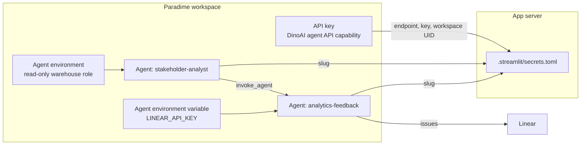
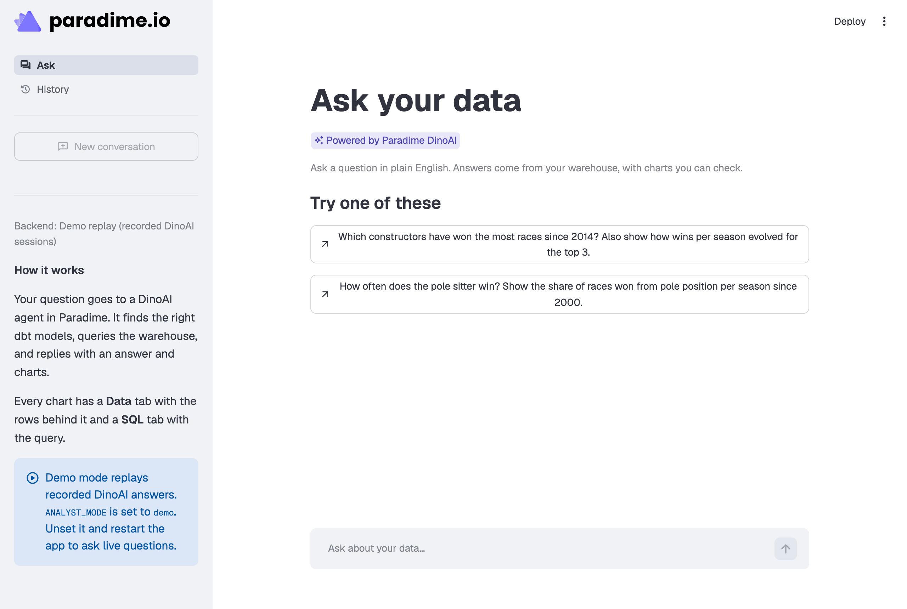

# Set up the app, end to end

This guide takes you from a fresh clone to a live app, in about 30 minutes. Do the steps in order. Each step says where the value comes from and where it goes.



## What you need

- A Paradime workspace with a warehouse connection and a dbt™ project. The agent works best with documented mart models.
- **Workspace admin** rights in that workspace. Only admins can create API keys, agent environment variables and budgets.
- Python 3.11 or later (3.12 is tested), and git.
- For **Report a problem**: a Linear workspace, the key of the team that gets the reports (for example `DNA`), and a Linear personal API key.

Where this guide says **Settings**, it means the settings screen of the Paradime app. Menu labels can move between releases. If a label differs, search the [Paradime docs](https://docs.paradime.io) for the page named in the step.

## Step 1. Get the code and run the demo

```bash
git clone https://github.com/paradime-io/dinoai-custom-bot-starter.git
cd dinoai-custom-bot-starter
python3 -m venv .venv
source .venv/bin/activate
pip install -r requirements-dev.txt
pytest -q
ANALYST_MODE=demo streamlit run app.py
```



The app opens in your browser in demo mode: it replays recorded DinoAI answers and needs no credentials. Select a starter question to see an answer with charts. If the tests pass and the demo works, your Python setup is correct.

## Step 2. Create a Paradime API key

The app calls the Paradime GraphQL API with an **account API key**.

1. In Paradime, go to **Settings** → **API Keys** and select **Generate API Key**.
2. Give the key a name, for example `ask-your-data app`.
3. Select the capability **DinoAI agent API**. It lets the key start agent runs and read their output. The app needs nothing else.
4. Select the workspace that the app will use. An admin can give a key access only to workspaces where they are an admin.
5. Optional: set an expiration date.
6. Generate the key, then select **Copy credentials**. This copies the key, the API endpoint, and each workspace name with its UID.

> **Caution:** Paradime shows the key only once. Store it in your password manager before you leave the screen.

You now have three values:

| Value | Example | Goes into |
| - | - | - |
| The key | `prdm_cmp_…` | `PARADIME_API_SECRET` |
| The API endpoint | `https://api.paradime.io/api/v1/<company_token>/graphql` | `PARADIME_API_ENDPOINT` |
| The workspace UID | `a1b2c3d4e5f6g7h8` | `PARADIME_WORKSPACE_UID` |

The endpoint depends on the region of your Paradime account (for example `api.paradime.io` or `api.us.paradime.io`), so copy it, do not type it. With an account key, the app sends `Authorization: Bearer <key>` and `X-Paradime-Workspace: <workspace UID>` on each request. A legacy workspace key pair (key and secret) also works: put the secret in `PARADIME_API_SECRET` and the key in `PARADIME_API_KEY`, and leave `PARADIME_WORKSPACE_UID` empty.

Source: [API keys](https://docs.paradime.io/developers/api-keys) and [Authentication](https://docs.paradime.io/developers/graphql-api/authentication) in the Paradime docs.

## Step 3. Create the two agents

The app needs one agent, and **Report a problem** needs a second one:

| Agent | Definition | What it does |
| - | - | - |
| `stakeholder-analyst` | `agent/stakeholder-analyst.yml` | Answers questions: finds the dbt models, runs SQL, writes the answer. Read-only. |
| `analytics-feedback` | `agent/analytics-feedback.yml` | Files a reader's report as a Linear issue. Only the analyst starts it. |

You can create each agent in the agent builder (option A) or as a YAML file in the workspace's repository (option B).

### Option A: in the agent builder

Create `analytics-feedback` first, so that you can select it in the analyst's squad.

1. In Paradime, open **DinoAI Agent** from the left navigation, select **Agents**, then **New agent**, then **Start from scratch**.
2. Fill in the form from the YAML file. Open the file in this repository and copy each field:

   | Builder field | YAML field |
   | - | - |
   | Name | `name` |
   | Role | `role` |
   | Goal | `goal` |
   | Backstory | `backstory` |
   | Tools → Allowed tools | `tools.list` (add each tool) |
   | Squad | `agents_squad` (the analyst only: select `analytics-feedback`) |
   | Environment | Workspace default, or the read-only environment from [step 5](#step-5-recommended-a-read-only-warehouse-role) |
   | Model | Default, or a faster preset |

3. Select **Deploy**, then **Just here**. The agent is live at once, without a file in your repository. An agent that is still a draft in the builder cannot be started from the API.
4. Open the agent again and copy its **slug** from the page address: `…/agent/builder/edit/<slug>?uuid=…`. An agent created in the builder gets a generated slug, for example `stakeholder-5029ee`. Do not try to guess it from the name.

Repeat for `stakeholder-analyst`. Its allowed tools are:

```text
run_sql_query, get_all_models, get_mart_models, get_node_details, get_lineage,
get_model_health, get_column_level_lineage, todo_write, todo_read,
invoke_agent, check_delegated_agents
```

and the feedback agent's allowed tools are:

```text
list_linear_issues, get_linear_issue, create_linear_issue, add_linear_comment, notify_parent_session
```

`read_file`, `ripgrep_search` and `search_files_and_directories` are core tools: every agent has them. You can also add your warehouse's metadata tools to the analyst (the YAML file lists them for BigQuery and Snowflake).

Source: [Creating agents in the app](https://docs.paradime.io/products/dino-ai/programmable-agents/creating-agents-in-the-app) and the programmable agents [FAQ](https://docs.paradime.io/products/dino-ai/programmable-agents/faq).

### Option B: as YAML in the repository

1. Copy `agent/stakeholder-analyst.yml` and `agent/analytics-feedback.yml` to `.dinoai/agents/` in the workspace's dbt repository.
2. Merge them into the **default branch**. Paradime reads agent files from the default branch, so that a feature branch cannot change an agent. A file that exists only on a feature branch is not visible to a run.
3. The slug of a YAML agent is its name, which is also its file name: `stakeholder-analyst` and `analytics-feedback`.

The `name` field must match the file name, or the agent does not run. The builder's **Deploy** → **Open a pull request** option writes the same file for you.

Source: [YAML configuration](https://docs.paradime.io/products/dino-ai/programmable-agents/yaml-configuration).

### Why the tool allowlist matters

`run_sql_query` runs the SQL that the agent writes, and stakeholders can type anything. Keep the `tools` block: an agent without it gets every tool. The analyst has no write tools, and only the feedback agent has Linear tools.

## Step 4. Connect Linear for the agents

The agents' Linear tools authenticate with a Linear API key that you store as an **agent environment variable**. The tools are available to agents only when this variable is set.

1. In Linear, go to **Settings** → **Security & access** → **Personal API keys** → **Create new API key**. Create it as a user that can create issues in the target team. A dedicated bot user makes the issues' author clear.
2. In Paradime, go to **Settings** → **Workspace Settings** → **Environment Variables**, open the **Agent** tab, and select **Add New**. If the workspace has more than one agent environment, add it for the environment that the feedback agent runs in: the workspace's default agent environment, unless you selected one in the agent's **Environment** field.
3. Add the variable `LINEAR_API_KEY` with the Linear key as its value.

An agent session sees the workspace's default variables plus the variables of its own agent environment, and it gets the Linear tools only when it can see `LINEAR_API_KEY`. Agent variables are separate from the Bolt and Code IDE variables. To check this step, run `python scripts/smoke_test.py --report` ([testing.md](testing.md#4-live-report)): it creates a real issue.

Source: [DinoAI background agent environment variables](https://docs.paradime.io/products/settings/environment-variables/dinoai-background-agent-environment-variables) in the Paradime docs. The variable name comes from the backend code of the agents' Linear tools (`is_linear_connected` reads `LINEAR_API_KEY`); the docs do not list it yet.

To assign each issue to a person, set `ANALYST_FEEDBACK_ASSIGNEE` in step 6. Assignment needs a Paradime release in which the agents' Linear tools accept an assignee email. Before that, the issue is created unassigned.

## Step 5. Recommended: a read-only warehouse role

The analyst runs SQL in your warehouse. Give it a connection that can only read the governed marts.

1. In your warehouse, create a role or service user with read-only access to the mart schemas.
2. In Paradime, go to **Settings** → **Environments**, select **Agent**, and create an environment with that connection.
3. Select the environment in the analyst's **Environment** field, or set `environment: <environment slug>` in its YAML file.

An unknown environment slug fails the session at start-up, so test with `scripts/smoke_test.py` after this step.

Source: [Creating agents in the app](https://docs.paradime.io/products/dino-ai/programmable-agents/creating-agents-in-the-app) (Environment section).

## Step 6. Configure the app

1. Copy the example file:
   ```bash
   cp .streamlit/secrets.toml.example .streamlit/secrets.toml
   ```
2. Fill in the values from the steps above:

   ```toml
   PARADIME_API_ENDPOINT = "https://api.paradime.io/api/v1/<company_token>/graphql"  # step 2
   PARADIME_API_SECRET = "prdm_cmp_..."                                              # step 2
   PARADIME_WORKSPACE_UID = "<workspace uid>"                                        # step 2
   DINOAI_AGENT = "<stakeholder-analyst slug>"                                       # step 3
   ANALYST_FEEDBACK_AGENT = "<analytics-feedback slug>"                              # step 3
   ANALYST_FEEDBACK_TEAM = "DNA"                                                     # your Linear team key
   ANALYST_FEEDBACK_ASSIGNEE = "data-owner@example.com"                              # optional
   ```

3. Describe your data in `ANALYST_CONTEXT` (the key marts, the metrics and their definitions, the fiscal calendar), and set `ANALYST_STARTER_QUESTIONS`. Good context makes answers faster, because the agent spends less time on discovery.

`.streamlit/secrets.toml` is in `.gitignore`. Never commit it. Every name can also come from an environment variable instead, but a name in the secrets file wins, even when its value is blank. See the [configuration reference](#configuration-reference) for every setting.

## Step 7. Check and test

```bash
python scripts/check_setup.py            # settings and access, starts nothing
python scripts/smoke_test.py             # one live question, 1 to 2 minutes
python scripts/smoke_test.py --report    # Report a problem, end to end: creates a real Linear issue
```

[testing.md](testing.md) explains each test and its expected output.

## Step 8. Run the app

```bash
streamlit run app.py
```

The sidebar shows the backend, the workspace and the agent session. Ask a question, then do the [manual test](testing.md#5-manual-test-in-the-app).

To run the app for other people:

- **Streamlit Community Cloud:** paste the contents of your `secrets.toml` into the app's **Secrets** setting.
- **A server or a container:** set the same names as environment variables, or mount a `secrets.toml` at `.streamlit/secrets.toml`. Keep `.threads/` on a persistent disk: it holds the conversations.
- On a public address, conversation links in Linear issues work for the data team. On `localhost`, the app leaves them out.

## Before real users

- **Sign-in.** The app has no authentication. Turn on Streamlit's OIDC sign-in (`st.login`) or put the app behind your SSO proxy. With sign-in, the History page shows who asked each question, and reports carry the reader's email.
- **Read-only access.** Do step 5.
- **Budget.** Each question is an agent turn that uses DinoAI credits. In **Settings** → **Budget & Consumption** → **DinoAI Credits**, on the **Workspace** tab, set a cap for background agents, and optionally a cap for each agent (**Cap (M)**, in millions of credits). Caps reset on the 1st of each month.
- **Secrets.** The API key stays on the server. Stakeholders never see it.
- **Who can read what.** Anyone who can open the app sees every conversation on the History page. Filter by the signed-in user if conversations must stay private.

## Configuration reference

| Name | Required | Description |
| - | - | - |
| `PARADIME_API_ENDPOINT` | Live mode | The GraphQL endpoint that Paradime shows with the API key. |
| `PARADIME_API_SECRET` | Live mode | An account key (`prdm_cmp_…`), or the secret of a legacy workspace key pair. |
| `PARADIME_WORKSPACE_UID` | With an account key | The workspace for the agent runs. |
| `PARADIME_API_KEY` | With a legacy key pair | The key of the legacy key pair. |
| `DINOAI_AGENT` | For Report a problem | The analyst agent's slug. Empty: the workspace's default agent, and Report a problem is off. |
| `DINOAI_MODEL_FAMILY` | No | A model family slug for each run, for example a Fast preset. Empty: the agent's own family. |
| `ANALYST_TITLE` | No | The app title. Default: `Ask your data`. |
| `ANALYST_CONTEXT` | No | Business context that the app sends at the start of each session. |
| `ANALYST_STARTER_QUESTIONS` | No | Starter questions: a TOML list, or one question on each line. |
| `ANALYST_FEEDBACK_AGENT` | No | The feedback agent's slug. It must be in the analyst's squad. Default: `analytics-feedback`. |
| `ANALYST_FEEDBACK_TEAM` | No | The key of the Linear team that gets the reports. Default: `DNA`. |
| `ANALYST_FEEDBACK_ASSIGNEE` | No | The email of the person who gets each report. Empty: the issue is unassigned. |
| `ANALYST_MODE` | No | `live` or `demo`. Default: `live` if `PARADIME_API_SECRET` is set. |
| `ANALYST_POLL_SECONDS` | No | The time between two reads of the run. Default: `1`. |
| `ANALYST_THREADS_DIR` | No | The folder for saved conversations. Default: `.threads/` next to `app.py`. |
| `ANALYST_REPLAY_SPEED` | No | Demo mode: how many times faster than the recording. Default: `4`. |
| `ANALYST_REPLAY_MIN_STEP` | No | Demo mode: the shortest time of one replay step, in seconds. Default: `2`. |

And in Paradime:

| Name | Where | Used by |
| - | - | - |
| `LINEAR_API_KEY` | Settings → Workspace Settings → Environment Variables → Agent tab, for the feedback agent's agent environment | The agents' Linear tools (the feedback agent) |
