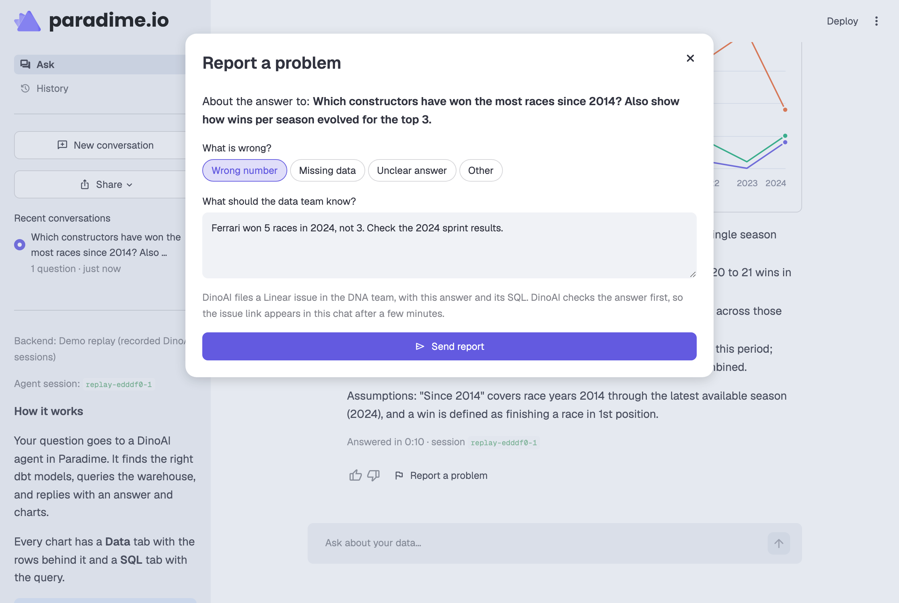
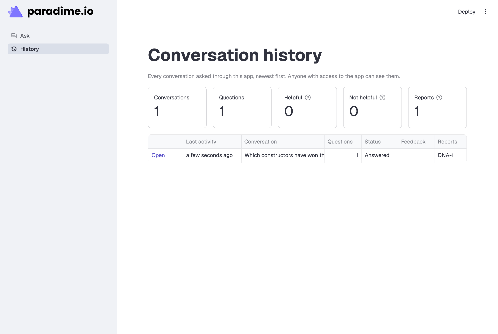

# Testing

There are four levels of tests. Run them in this order: each level needs more setup than the one before, and the last one creates a real Linear issue.

| Level | Command | Needs | Creates |
| - | - | - | - |
| 1. Automated tests | `pytest -q` | Nothing | Nothing |
| 2. Setup check | `python scripts/check_setup.py` | Paradime credentials | Nothing |
| 3. Live question | `python scripts/smoke_test.py` | The analyst agent | One agent session |
| 4. Live report | `python scripts/smoke_test.py --report` | Both agents and Linear | One agent session and one **real Linear issue** |

Then do the [manual test in the app](#5-manual-test-in-the-app).

Run the commands from the repository root, with the virtual environment active (`source .venv/bin/activate`), or prefix them with `.venv/bin/`.

## 1. Automated tests

```bash
pytest -q
```

About 115 tests run in less than 10 seconds. They need no credentials and make no network calls: the app runs in demo mode. They cover:

- the response contract: the parser, compact rows, broken JSON, every chart type in light and dark mode;
- the turn logic, including a follow-up that sees the status of the previous turn;
- both backends, with the Paradime SDK answered locally;
- the thread store, the history, the Markdown export;
- the report flow: the brief for the analyst, the issue-link watcher, and a full demo run of the app with `AppTest` (question, report, acknowledgement, issue link);
- the request sanitizer, and the setup check's diagnosis.

The tests never read your `.streamlit/secrets.toml` or your shell's `PARADIME_*` variables (see `tests/conftest.py`). GitHub Actions runs them on every push and pull request (`.github/workflows/tests.yml`).

## 2. Setup check

```bash
python scripts/check_setup.py
```

The script reads your settings the way the app does, and shows where each value comes from (`secrets.toml` or the environment). Then it reads a DinoAI session that does not exist. Paradime answers "not found" only when the key, the workspace and the agents API all work. No agent run starts.

Expected output, at the end:

```text
Paradime access
  PASS  The key, the workspace and the agents API work.

Report a problem
  PASS  The analyst hands reports to 'analytics-fe-98e818'.
  NOTE  Not checkable from here: LINEAR_API_KEY in the workspace's agent environment
        variables, and the analyst's tools and squad. scripts/smoke_test.py --report tests them.

All checks passed.
```

If a check fails, the line says what to fix. See also [troubleshooting.md](troubleshooting.md).

## 3. Live question

```bash
python scripts/smoke_test.py
python scripts/smoke_test.py --question "How many races did Red Bull win in 2023? Show it as a metric."
```

The script sends one question to `DINOAI_AGENT`, with the same opening message as the app. It waits for the answer, then checks that the answer follows the response format: Markdown with at least one `viz` block that the app can draw. It takes 1 to 2 minutes, most of it for the agent pod to start.

Expected output:

```text
1. Question to stakeholder-5029ee: How many races did each constructor win in 2023? Show it as a bar chart.
   DinoAI session lj6arfghat5qjvub
   Answered in 56s: 1 visual(s), 0 unreadable
     - bar: Race wins by constructor, 2023
PASS  The agent answered in the app's format.
      Open it in the app: http://localhost:8501/?thread=lj6arfghat5qjvub
```

Open the link with the app running to see the answer as a stakeholder sees it. You can also read the session in Paradime: every tool call of the agent is in its transcript.

## 4. Live report

> **Caution:** This step creates a real Linear issue in `ANALYST_FEEDBACK_TEAM`. Close it after the test.

```bash
python scripts/smoke_test.py --report
```

After the question, the script reports a problem with the answer, as the app's dialog does (category "Other", comment "Smoke test …"). Then it waits for:

1. the analyst's acknowledgement (about 2 minutes: the analyst can run one query to check the report first);
2. the Linear issue link, which the analyst posts when the feedback agent calls back (about 4 minutes after the report).

Expected output, at the end:

```text
3. Waiting for the Linear issue link (usually a few minutes)...
   After 222s: The issue is filed as [DNA-96](https://linear.app/...), currently unassigned ...
   Feedback agent session(s): a75k3fw0tz0kf9uh
PASS  Filed DNA-96: https://linear.app/...
      Close this issue in Linear: it was a test.
```

If no link comes within 10 minutes, open the feedback agent's session in Paradime (its ID is in the output, or in the analyst session's child sessions) and read what it did. The usual causes are in [troubleshooting.md](troubleshooting.md#report-a-problem).

## 5. Manual test in the app

Start the app with `streamlit run app.py` and do these steps:

1. Select a starter question. A status line shows the agent's progress and a timer. The answer comes with charts.
2. On a chart, open the **Data** and **SQL** tabs. The rows and the query are there.
3. Ask a follow-up, for example "And for 2022?". It goes to the same session and comes back faster (the pod is warm).
4. Reload the page. The same conversation opens again (`?thread=` in the URL).
5. Select **Share** in the sidebar. Copy the link, and download the conversation as Markdown.
6. Select **Report a problem** under an answer. Select a category, add a comment, and send it. The analyst acknowledges the report. A few minutes later, the issue link appears, and the report shows **Filed as DNA-…**.

   

7. Open the **History** page. The conversation is there, with its number of questions, its feedback and its Linear issue.

   

In demo mode, steps 1 to 7 work without credentials. The report gets a demo link (`DNA-1`) and no real issue.

## After a test

- Close the test issues in Linear.
- Delete test conversations from the History page by deleting their files in `.threads/` (one JSON file for each conversation).
